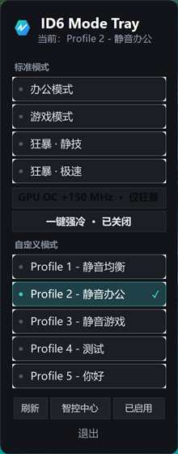

# ID6 Mode Tray

ID6 Mode Tray 是一个轻量的 Windows 托盘模式切换器，用来快速切换 ID6 笔记本上智控中心提供的性能模式。

它不是智控中心的替代品，而是一个更顺手的小托盘入口：保留原厂智控中心和 `GCUBridge` 服务负责真正的设备控制，Mode Tray 只向本机服务发送已观察到的 MQTT 控制命令，并读取智控中心现有配置文件来显示当前状态。



## 当前功能

- 托盘图标左键或右键打开模式面板
- 切换办公、游戏、狂暴静谧、狂暴极限等标准模式
- 自动发现已启用的自定义 Profile
- 在狂暴模式下切换 GPU OC +150 MHz
- 一键开启或关闭强冷
- 显示当前模式和操作结果提示
- 可选设置开机自启动
- 提供命令行入口，方便脚本或快捷方式调用

## 运行要求

- Windows
- 已安装并可正常运行的智控中心
- 智控中心的 `GCUBridge` MQTT 服务正在本机运行
- .NET 8 Windows Desktop Runtime，或使用自包含发布包

程序默认连接本机 `127.0.0.1:13688`，并向 `Fan/Control` topic 发布控制消息。它不会直接写入固件，也不安装驱动。

## 测试设备

已在机械师曙光 16S Ultra 7 255HX + RTX 5070 Ti 上测试通过，其他配置暂未通过验证。

## 使用方式

运行 `ID6ModeTray.exe` 后，系统托盘会出现 ID6 Mode Tray 图标。点击图标即可打开面板：

- 上半部分是标准模式
- 中间是 GPU OC 和强冷开关
- 下半部分是自定义 Profile
- 底部按钮可刷新状态、打开智控中心、切换开机启动或退出

自定义 Profile 会从智控中心配置目录中的 `Mode4_Profile*.json` 自动发现，只显示 `Activated=true` 的槽位。如果 `profiles.json` 中存在相同 `profileIndex` 的条目，其 `label` 可作为显示名称兜底或覆盖。

## 命令行

可以直接用命令行切换模式：

```powershell
ID6ModeTray.exe --switch office
ID6ModeTray.exe --switch gaming
ID6ModeTray.exe --switch turbo
ID6ModeTray.exe --switch turbo:silent
ID6ModeTray.exe --switch turbo:extreme
ID6ModeTray.exe --switch custom:2
```

也可以单独切换强冷或 GPU OC：

```powershell
ID6ModeTray.exe --fan-boost on
ID6ModeTray.exe --fan-boost off

ID6ModeTray.exe --oc on
ID6ModeTray.exe --oc off
```

注意：`--oc on/off` 只在当前处于狂暴模式时可用。

## 配置文件

`profiles.json` 跟随程序复制到输出目录，用来定义默认显示项和命令映射。一个条目包含：

```json
{
  "label": "办公模式",
  "action": "OPERATING_OFFICE_MODE",
  "operatingMode": 0,
  "profileIndex": 0
}
```

字段含义：

- `label`：界面显示名称
- `action`：发送给 `GCUBridge` 的动作名称
- `operatingMode`：智控中心模式编号
- `profileIndex`：模式或 Profile 槽位编号
- `silent` / `extreme`：狂暴模式下的细分状态匹配

程序运行时还会读取智控中心自己的状态和 Profile 文件，例如：

- `MainOption.json`
- `Mode3_Profile*.json`
- `Mode4_Profile*.json`
- UWP package settings 中的自定义 Profile 别名

这些文件只用于读取状态和显示名称；Mode Tray 本身不会修改它们。

## 构建

项目使用 .NET 8 WinForms：

```powershell
dotnet build ModeTray\ModeTray.csproj -c Release
```

当前项目引用本地的 `ModeTray\lib\M2Mqtt.Net.dll`：

```xml
<Reference Include="M2Mqtt.Net">
  <HintPath>lib\M2Mqtt.Net.dll</HintPath>
</Reference>
```

这个 DLL 没有提交到仓库。发布公开版本前，应改成可审计、可再现的依赖方式，例如：

- 使用有明确许可证的 NuGet 包
- 将依赖源码作为合法子模块或第三方目录引入
- 在 release 说明中明确二进制来源和许可证

## 图标

源码中包含 SVG 图标和生成 `.ico` 的脚本：

```powershell
ModeTray\scripts\generate-icon.ps1
```

如果重新生成图标，请确认生成结果仍位于：

```text
ModeTray\assets\id6-mode.ico
```

## 日志

程序会在运行目录写入：

```text
ID6ModeTray.log
```

日志用于记录启动、MQTT 连接、命令发送、状态等待和异常信息。日志文件属于运行产物，不应提交。

## 已知限制

- 依赖智控中心和 `GCUBridge` 服务；如果服务未运行，切换会失败
- 当前 MQTT 地址、topic、client id、用户名和密码来自本机观察结果，可能随智控中心版本变化
- GPU OC 开关目前固定为 `+150 MHz` 和 `0 MHz`
- 目前没有安装器，也没有自动部署运行时
- 仓库暂不包含第三方 MQTT DLL，因此干净 clone 后需要先补齐依赖或调整项目引用

## 发布和风险边界

这个项目是非官方兼容工具，不包含也不应包含下列材料：

- 智控中心安装目录的 DLL、EXE、资源文件或压缩嵌入依赖
- 反编译得到的 IL、资源转储或专有源码
- 驱动构建产物、测试证书、签名文件
- OpenRGB 或其他上游项目源码快照，除非以合适的子模块或许可证方式引入

仓库中的 `.gitignore` 使用保守白名单策略，目的是避免把本地分析材料、构建产物或厂商文件误提交。

## 免责声明

ID6 Mode Tray 与设备厂商或智控中心开发方无隶属、背书或授权关系。使用前请理解它会向本机智控中心服务发送性能和风扇相关控制命令；由此产生的功耗、噪音、温度或稳定性变化需要自行承担。
